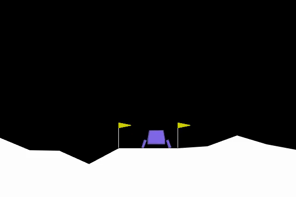

# Lunar Lander AI

Train a neural-network pilot to land a rocket using Gymnasium's `LunarLander-v3` and Stable Baselines3 PPO. Runs locally on CPU; no API key needed.



## Included trained pilot

The tested model is `models/lander-ppo.zip`. It averaged **222.46** reward (standard deviation **30.93**) over 100 episodes with seeds 20000–20099, compared with **−185.45** for random actions on the same seeds. See `results/trained.json` and `results/random.json` for raw results. The model checkpoint was trained for 400,000 transitions; the run was stopped early at 524,288 after the test target was met. This is one training seed, not a claim of consistent performance across independent training runs.

```sh
# After completing Setup below:
python lander.py watch --model models/lander-ppo.zip
```

Watch the [three-episode demo](demo/landing.mp4). The tested model, demo, and evaluation results are included. New training outputs under `runs/` and the Python virtual environment are excluded from Git.

## Setup

Python 3.11–3.13 recommended.

```sh
python3 -m venv .venv
source .venv/bin/activate
pip install -r requirements.txt
```

`requirements-lock.txt` records the exact versions tested on this Mac; use `pip install -r requirements-lock.txt` to reproduce that environment.

If Box2D needs to build from source, install `swig` with pip first, then retry.

## Train and watch

```sh
python lander.py evaluate --random --episodes 100 --output runs/random.json
python lander.py train --steps 1000000 --run runs/lander
python lander.py evaluate --model runs/lander/best/best_model.zip --episodes 100 --output runs/trained.json
python lander.py watch --model runs/lander/best/best_model.zip
python lander.py watch --model runs/lander/best/best_model.zip --episodes 3 --video runs/landing.mp4
```

Training can take minutes to hours depending on hardware. One million steps is a starting budget, not a guarantee of success. Compare random and trained policies on the same evaluation seeds. A mean score of 200 over 100 episodes is the conventional target; reward is not a landing success percentage.

The best model is selected every 20,000 training transitions using 10 validation episodes. Training uses four environments. Evaluation defaults to separate seeds beginning at 20,000. The default reward already encourages approach, low speed, upright posture, and ground contact while penalizing engine use and crashes. No extra reward shaping is added, so scores remain comparable to the standard environment.

`runs/lander/progress.csv` contains training metrics, `episodes/` contains per-episode rewards, and `eval/evaluations.npz` contains validation results. `final_model.zip` saves the last policy; `best/best_model.zip` saves the strongest validation policy. Very short training runs may only produce the final model. Ctrl-C saves current progress. Existing run directories are never overwritten.

Continue training into a new directory:

```sh
python lander.py train --resume runs/lander/final_model.zip --run runs/lander-v2 --steps 500000
```

Quick end-to-end smoke check (does not produce a skilled pilot):

```sh
python lander.py train --steps 4096 --run runs/smoke
python lander.py evaluate --model runs/smoke/final_model.zip --episodes 2
```

## How learning works

The simulator supplies eight values: position, velocity, angle, angular velocity, and contact for each leg. The policy chooses one of four actions: idle, left engine, main engine, or right engine. PPO updates the policy from repeated simulated flights to increase expected reward. Watching uses deterministic actions from the learned policy.

Sources: [Gymnasium Lunar Lander](https://gymnasium.farama.org/environments/box2d/lunar_lander/) and [Stable Baselines3 PPO](https://stable-baselines3.readthedocs.io/en/master/modules/ppo.html).
